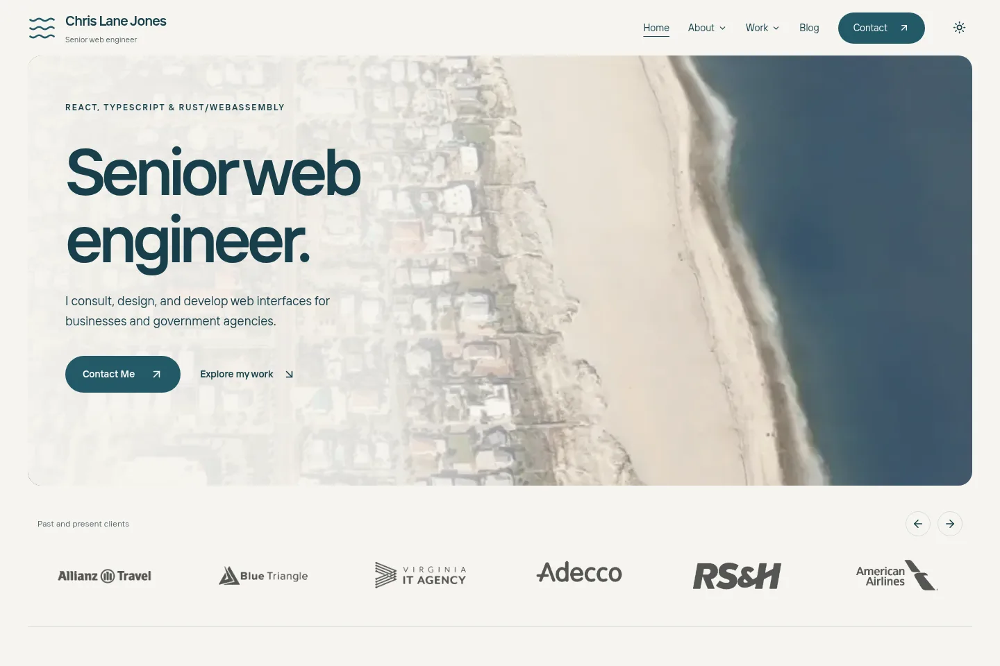
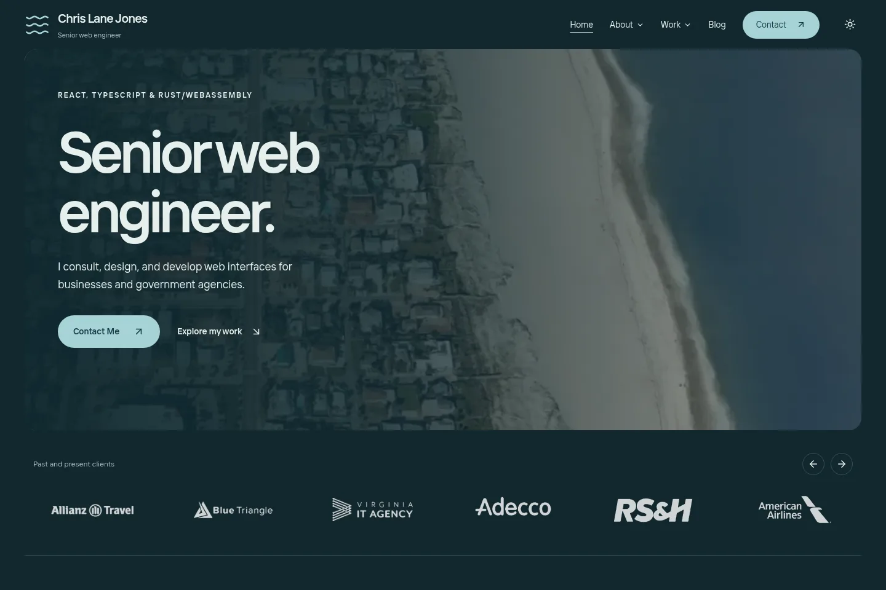

# Chris Lane Jones — Beach Portfolio

A coastal home for my work, writing, and life beyond the browser. The 2026 beach version pairs Next.js, React and Convex with recorded St. Augustine Beach scenes and an interactive sandcastle.

[Portfolio](https://www.chrislanejones.com) · [Getting started](docs/chapters/01-getting-started/README.md) · [Change summary](docs/Change-summary.md)



<details>
<summary>View dark mode</summary>



</details>

## Read the book

Start at chapter 1 or open the area you are working on. Each chapter has its own README, source references, and links to the previous and next chapters.

| Chapter | Read more |
| --- | --- |
| 1 | [Getting started](docs/chapters/01-getting-started/README.md) |
| 2 | [Architecture and file map](docs/chapters/02-architecture/README.md) |
| 3 | [Pages and features](docs/chapters/03-features/README.md) |
| 4 | [Coastal design and scenes](docs/chapters/04-design-and-scenes/README.md) |
| 5 | [Content and media](docs/chapters/05-content-and-media/README.md) |
| 6 | [Authentication and security](docs/chapters/06-security/README.md) |
| 7 | [Search and metadata](docs/chapters/07-seo/README.md) |
| 8 | [Testing and dependencies](docs/chapters/08-maintenance/README.md) |
| 9 | [Deployment and operations](docs/chapters/09-deployment/README.md) |
| 10 | [Architecture decision records](docs/adr/README.md) |

[Full documentation index](docs/README.md) · [Design reference](docs/SIMPLE-DESIGN-GUIDE.md)

## Quick start

Use Node.js 22.13+ or 24+ and pnpm. Configure the Convex, Clerk and other integration values using [chapter 1](docs/chapters/01-getting-started/README.md), then:

```bash
pnpm install --frozen-lockfile
pnpm run dev
```

Open [localhost:3000](http://localhost:3000). A repository clone does not include the connected Convex database or hosted media. Public pages read Convex without Clerk; admin access uses Clerk and an owner allowlist.

## Stack

Next.js App Router · React · TypeScript · Convex · Clerk · UploadThing · Tailwind CSS and CSS Modules · React Three Fiber/Three.js · Vitest

The hero uses WebP stills and optional recorded video loops; live WebGL is loaded separately for interactive beach features. Exact dependency versions are in [package.json](package.json) and [pnpm-lock.yaml](pnpm-lock.yaml).

## Current work

The [change summary](docs/Change-summary.md) distinguishes local work from released changes. The documentation covers the beach version, including the current rendering, content, security and deployment boundaries; it does not recreate the original site's decision history.

## License and author

Code is available under the [MIT License](LICENSE). Third-party logos, photography, fonts and other media may have their own terms.

Built by [Chris Lane Jones](https://www.chrislanejones.com) · [GitHub](https://github.com/chrislanejones) · [LinkedIn](https://linkedin.com/in/chrislanejones)
