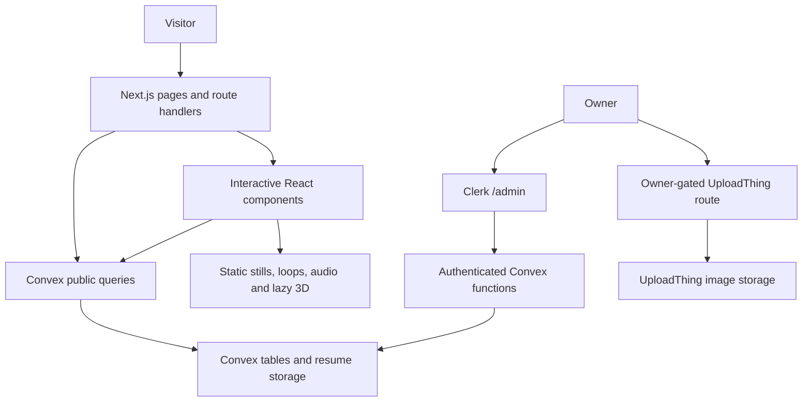

# Chapter 2: Architecture and file map

[Book contents](../../README.md) · [Project home](../../../README.md) · [Previous chapter](../01-getting-started/README.md) · [Next chapter](../03-features/README.md)

The beach portfolio uses Next.js App Router for routes, metadata, server rendering and API handlers. React client components provide interactive islands. Convex owns editable content and public-write workflows; local TypeScript files hold presentation rules and selected fallbacks.

## Rendering boundaries

- The root layout wraps pages in `ConvexClientProvider`; public reads do not require Clerk.
- `/admin` uses `ConvexAdminProvider`, the Clerk `convex` JWT template, and server-side owner checks. Backend mutations check the owner independently.
- Blog and conference route data can be fetched on the server. Some public sections still subscribe with `useQuery` and local loading/fallback content; do not assume every route is server-populated.
- Browser Tabs preloads its public query in the server page, then uses `usePreloadedQuery` for hydration and live updates. Its links are present in HTML before JavaScript executes.
- The hero and page banners use static images and optional recorded loops. The sandcastle and decorative coast remain separate lazy-loaded WebGL features.

## File map

| Location | Responsibility |
| --- | --- |
| [src/app](../../../src/app/) | Routes, layouts, metadata, admin, downloads and upload handlers |
| [src/components/coastal](../../../src/components/coastal/) | Public beach UI, recorded scenes and interactive 3D |
| [src/components/ui](../../../src/components/ui/) | Shared Radix-based controls, drawers and dialogs |
| [src/components/blog](../../../src/components/blog/) | Interactive article components |
| [src/data](../../../src/data/) | Local presentation data, photo lists and fallbacks |
| [src/lib](../../../src/lib/) | SEO, sanitization, theme store and project URL helpers |
| [src/providers](../../../src/providers/) | Public/admin Convex providers and deferred analytics |
| [convex](../../../convex/) | Schema, functions, HTTP endpoints and generated bindings |
| [public](../../../public/) | Theme-specific stills, videos, audio, fonts and downloads |
| [scripts](../../../scripts/) | Maintenance utilities; inspect targets before running |

Read [ADR-010](../../adr/010-app-router-and-auth-boundaries.md) and [ADR-014](../../adr/014-convex-content-and-local-presentation.md). Existing backend choices are documented only as they apply to the beach site; this handbook does not reconstruct the original site's history.

---

[Book contents](../../README.md) · [Project home](../../../README.md) · [Previous chapter](../01-getting-started/README.md) · [Next chapter](../03-features/README.md)
